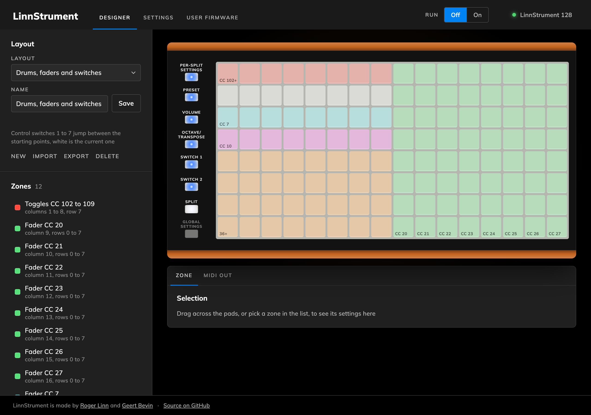

An unofficial LinnStrument firmware with XY-tuning
==================================================

This is an unofficial modification of LinnStrument's firmware, with a flexible way of tuning the keys. You can find about LinnStrument and its official firmware from these pages:

  https://www.rogerlinndesign.com/linnstrument  
  https://github.com/rogerlinndesign/linnstrument-firmware

The inspiration and reason for this modification can be found in this post:

  https://www.kvraudio.com/forum/viewtopic.php?f=263&t=559271

### Motivation

The original LinnStument has one parameter for setting the _row offset_, which is good for most use cases. The LinnStrument's total range is mostly limited by the number of rows, because no matter how many columns you have, the keys will be mostly duplicated because each row only shifts a few notes to the left. The default number of shifts (called row offset) is 5, which is fourth tuning like a guitar.

Some people have found ways to use the LinnStrument turned 90 degrees so that they can have more rows. This can achieve a large range comparable to a grand piano. For example, Jesse Washmon's playing piano pieces with LinnStrument:

  https://www.youtube.com/watch?v=KdGFXX-kAig  
  https://www.youtube.com/watch?v=164qLQyt29g

Without changing the firmware, this vertical configuration will need extra software, and will be complex and inflexible, so I decided to modify the firmware. I added a setting called _column offset_ to global settings for this purpose.

This parameter makes it possible to achieve a large range. In addition to the vertical way of playing, it also allows you to use LinnStrument like a Janko keyboard etc.

### Installing the firmware from binary

To install the pre-built firmware, you can use the [Updater app](https://github.com/yinwang0/linnstrument-firmware/blob/xy-tuning/updater/LinnStrument%20Updater%20(XY-tuning).zip) from the updater directory. This should upate the firmware safely, saving the settings etc. This is just the official updater app with the bin file replaced with compiled binary from this branch. To distinguish it from the original firmware, I changed the version number to 223.

### Buiding the firmware from source code

You can follow these instructions on LinnStrument's support page for compiling the firmware:

  https://www.rogerlinndesign.com/support/support-linnstrument-source-code

Notice two additional things for a "safe update":

  1. From Arduino IDE's preferences, you need to check _"Show verbose output during..."_ for compiling and uploading in order to see where the compiled files are.
  2. In order to copy the compiled firmware binary into the LinnStrument Updater app, you need to right click on the app, and choose _Show Package Contents_, and then find the location of the file in _Resources_ directory.

### How to use vertical tunings

This modified firmware will behave almost the same as the old one if you don't do anything special. I just modified the bahavior of the +7 row offset button to set a new parameter called _column offset_ which will let you use LinnStrument vertically.

To use the vertical mode:

1. Press and hold the +7 row offset button, the slider screen for _column offset_ will appear. Here, set the column offset to 5.

2. Press and hold the +OCTAVE row offset button, the slider screen for _custom row offset_ will appear. Here, set custom row offset to -1.

Turn LinnStrument 90 degrees counterclockwise with the buttons facing you, then you can play LinnStrument with _vertical fourth tuning_.

If you like to use _vertical third tuning_ or _vertical tritone tuning_, just set column offset to the desired number (4 or 6).

Notice that with this modified firmware, the +7 row offset button will not work in the old way. It is modifed to have the new function for setting the _column offset_ parameter. If you need fifth tuning, you will need to press and hold the +OCTAVE button and set the _custom row offset_ to +7.

### Other tunings

The column offset parameter can also allow you to use some other interesting tunings.

First let's see how _column offset_ works. Let's call the row offset "R" and the column offset "C", then the original fourth tuning can be expressed as "R:+5 C:+1", which means _If you go up one row, increase 5 semitones. If you go right one column, increase 1 semitone_. Similarly, the usual fifth tuning can be expressed as "R:+7 C:+1". In the original firmware, the column offset is always 1. It was hardcoded and you can't change it. My modification is just to enable you to set this parameter yourself.

With the column offset parameter, you can use LinnStrument in these interesting ways:

- A vertical fourth tuning as used by Jesse Washmon for this piano playing can be expressed as "R:-1 H:+5".
- Vertical thirds tuning can be expressed as "R:-1 V:4". I like to use this one.
- Janko layout can be expressed as "R:1 C:2".

You can try other settings too.

### About pitch slides

I haven't changed anything about pitch slides, so after turning the LinnStrument 90 degrees, pitch slides will still work in its old way. This means that you need to slide up/down instead of left/right for pitch slides.

This may not be intuitive, but consider that most people will use this vertical way for piano pieces without pitch slides, this might be okay.

### Feedback

If you have questions, suggestions, please file an issue on GitHub, I'll try my best to improve this while I have time.

I hope you find this way fun to use!

-------------------------------------------------------------------------------------------------
-------------------------------------------------------------------------------------------------
-------------------------------------------------------------------------------------------------

LinnStrument
============

This is the firmware for LinnStrument, the expressive MIDI controller made by Roger Linn Design,
together with the tools around it. The firmware runs on the Arduino Due (Atmel/Microchip SAM3X8E) inside the instrument.
The repository is set up so that anyone can work on it with an AI coding assistant, musicians
included, not only programmers.

Three ways in
-------------

1. **Use the browser pages, nothing to install.** The [browser pages](examples/README.md) talk
   to a LinnStrument over MIDI from Chrome, Edge or Firefox. There's a surface designer that
   turns the instrument into a custom controller of pads, keys, faders, XY pads and buttons for
   any DAW, an editor for every setting, and a live view of User Firmware Mode. Just open
   https://uwyn.com/linnstrument/ in Chrome, Edge or Firefox (Safari has no MIDI for web pages),
   allow MIDI when the browser asks, open one of the pages and pick the instrument at the top
   right. [examples/README.md](examples/README.md) describes them, and how to run them from a
   copy of this repository instead. They work with the current release,
   2.3.4. The next firmware, 2.4.0, isn't released yet and adds model detection, faster lighting
   and text. Until then, the connection panel tells you what's waiting for it.

2. **Change the firmware without installing anything.** Claude Code on the web edits the
   firmware on a branch in the cloud. Every push is compiled by GitHub Actions, which attaches
   the firmware file to the run, and the LinnStrument Updater flashes it while keeping your
   settings. "On the web, start to finish" in [CONTRIBUTING.md](CONTRIBUTING.md) lists the
   steps, and the rest of that file has the prompts to start with and tells you what's safe.

3. **Develop on your own computer, with or without an assistant.** Plain development works as it
   always has. You can open `linnstrument-firmware.ino` in Arduino IDE 2.x and press Verify,
   after copying its one library (see `CONTRIBUTING.md`), or build from the command line with Go
   and arduino-cli. A desktop test suite checks the firmware's logic in seconds without an
   instrument, the Virtual LinnStrument runs the firmware behind a window with a virtual MIDI
   port, and a pull request brings the change in. An AI assistant in the terminal can drive all
   of that for you and, when you say so, a connected instrument too. `CONTRIBUTING.md` lists
   what to install and the workflow, and its "On a Mac, start to finish" lists the steps with an
   assistant. `CLAUDE.md` is what the assistant reads (other assistants find it through
   `AGENTS.md`), and it's useful reading for people too.

For the browser pages, the first way in and `examples/README.md` are all you need. To change the
firmware, start with this file and then read `CONTRIBUTING.md`, which takes half an hour and
covers the workflow, safety and working with an assistant. After that, read `CLAUDE.md` when you
want to know how the firmware is built, how it runs and what it must not do.

Building
--------

The sources are an Arduino sketch. They build with Arduino IDE 2.x or with arduino-cli, using
the Arduino SAM Boards core version 1.6.12 (select the board "Arduino Due (Native USB Port)").
Other versions of the SAM core are untested and may create unknown build or execution problems.

To build from the command line, you need Go and arduino-cli installed. After running
`arduino-cli core install arduino:sam@1.6.12` once, `go run ./tools/linnstrument build` compiles
the firmware into `build/` and `go run ./tools/linnstrument test` runs the desktop tests in
`tests/`. The same tool flashes a unit and backs up and restores its settings. `tools/virtual/`
builds the Virtual LinnStrument. Every push to GitHub is also compiled by GitHub Actions, which
attaches the resulting `.bin` file, the tool and the Virtual LinnStrument for Apple silicon Macs
to the workflow run, so you don't have to install anything to get a build.

On Apple silicon Macs, the Arduino SAM toolchain is an Intel binary and needs Rosetta installed
(`softwareupdate --install-rosetta`).

Flash a `.bin` with the LinnStrument Updater, which keeps your settings. It flashes the `.bin`
in the folder it sits in, so on a Mac, drag the unzipped app into a folder holding your file.
Left where it was unzipped, it doesn't see the file. `CONTRIBUTING.md` has the steps and the way
back. Note that uploading with bossac or the Arduino IDE directly erases all settings and
calibration.

Contributing
------------

See `CONTRIBUTING.md` for the branch and pull request workflow, what to install, what's safe and
what isn't, and how to work on this code with an AI coding assistant.

> This repo fork however has been used to rebuild the firmware using a fresh Arduino IDE + CLI version (see below) and nothing extremely nasty jumped at us yet. Fingers crosssed...

## Developer Notes

> This repo fork however has been used to rebuild the firmware using a fresh Arduino IDE + CLI version (see below) and nothing extremely nasty jumped at us yet. Fingers crosssed...

To rebuild the LinnStrument / MicroLinn firmware binary, set up your development environment as follows: 

- download and install the Arduino IDE v2.x (tested with v2.3.10)
- download and install the Arduino CLI (tested with v1.4.1)
- start the Arduino IDE
- wait a little bit for the board package specs to download (particularly when you have added additional boards' package JSON URLs to the Arduino IDE preferences)
- click on the Board Manager icon: a sidebar with a list of available board packages shows up
- search for `due`: find `Arduino SAM boards (32 bits ARM Cortex M3`
- install this board package (currently at v1.6.12)
- open the `linnstrument-firmware`/`MicroLINN` repo base directory
- pick any of the `*.ino` sketch files to open in the Arduino IDE: it should subsequently open *all of them*. (I prefer to use `ls_main.ino` for this pick & open action.)
- hit the build/*Verify* button in the IDE to compile the whole kaboodle...
- *profit!*

### Pro Tip

In the Arduino IDE preferences, turn on "*All*" Warnings for the compiler: compiler warnings may seem useless and verbose sometimes, but they *are* important!

This repo fork has a special `ls_compiler_tweaks.h` header file which deals with the obnoxious warnings, while letting through all the (useful) others...

Further info:

- https://docs.arduino.cc/arduino-cli/sketch-build-process/
- https://docs.arduino.cc/arduino-cli/sketch-specification/
- 

## Support

Note that customer bug reports or feature requests shouldn't be posted here. Instead, email
Roger at support@rogerlinndesign.com.
